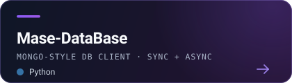
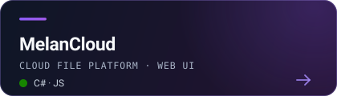
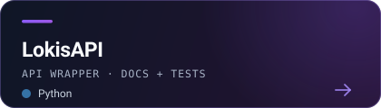
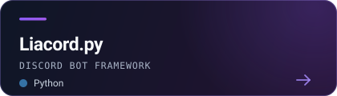

<!--
   ███╗   ███╗ █████╗ ███████╗███████╗███████╗███████╗██╗   ██╗
   ████╗ ████║██╔══██╗██╔════╝██╔════╝╚══███╔╝██╔════╝██║   ██║
   ██╔████╔██║███████║███████╗█████╗    ███╔╝ █████╗  ██║   ██║
   ██║╚██╔╝██║██╔══██║╚════██║██╔══╝   ███╔╝  ██╔══╝  ╚██╗ ██╔╝
   ██║ ╚═╝ ██║██║  ██║███████║███████╗███████╗███████╗ ╚████╔╝
   ╚═╝     ╚═╝╚═╝  ╚═╝╚══════╝╚══════╝╚══════╝╚══════╝  ╚═══╝

   Профиль MaseZev.
   Баннеры, карточки проектов и футер — локальные SVG в папке /assets,
   они автоматически переключаются между тёмной и светлой темой GitHub.
-->

<picture>
  <source media="(prefers-color-scheme: dark)" srcset="assets/banner-dark.svg">
  <source media="(prefers-color-scheme: light)" srcset="assets/banner-light.svg">
  
</picture>

### Привет 👋 Меня зовут Никита

`Bots dev` · `Backend dev` · `Frontend dev` · `Content maker`

18 лет, любимое дело и много кода. Занимайся любимым делом, развивайся и веселись — **у тебя всё получится, я в тебя верю.**

---

## 🧰 Стек

&nbsp;&nbsp;
&nbsp;&nbsp;
&nbsp;&nbsp;
&nbsp;&nbsp;
&nbsp;&nbsp;
&nbsp;&nbsp;
&nbsp;&nbsp;
&nbsp;&nbsp;
&nbsp;&nbsp;
&nbsp;&nbsp;
&nbsp;&nbsp;

---

## ✨ Чем занимаюсь

<table>
  <tr>
    <td width="25%" align="center" valign="top">🤖 <b>Bots</b> Discord и Telegram: команды, события, панели</td>
    <td width="25%" align="center" valign="top">⚙️ <b>Backend</b> Python и C#: API, базы, библиотеки</td>
    <td width="25%" align="center" valign="top">🎨 <b>Frontend</b> Веб-интерфейсы, дашборды, лендинги</td>
    <td width="25%" align="center" valign="top">🎬 <b>Content</b> Тексты, видео и оформление</td>
  </tr>
</table>

---

## 🚀 Проекты

<a href="https://github.com/MaseZev/Mase-DataBase"><picture>
  <source media="(prefers-color-scheme: dark)" srcset="assets/card-masedb-dark.svg">
  <source media="(prefers-color-scheme: light)" srcset="assets/card-masedb-light.svg">
  
</picture></a>
<a href="https://github.com/MaseZev/MelanCloud"><picture>
  <source media="(prefers-color-scheme: dark)" srcset="assets/card-melancloud-dark.svg">
  <source media="(prefers-color-scheme: light)" srcset="assets/card-melancloud-light.svg">
  
</picture></a>

<a href="https://github.com/MaseZev/lokisapi-python"><picture>
  <source media="(prefers-color-scheme: dark)" srcset="assets/card-lokisapi-dark.svg">
  <source media="(prefers-color-scheme: light)" srcset="assets/card-lokisapi-light.svg">
  
</picture></a>
<a href="https://github.com/MaseZev/Liacord.py"><picture>
  <source media="(prefers-color-scheme: dark)" srcset="assets/card-liacord-dark.svg">
  <source media="(prefers-color-scheme: light)" srcset="assets/card-liacord-light.svg">
  
</picture></a>

<a href="https://github.com/MaseZev?tab=repositories"><b>→ все репозитории</b></a>

---

## 📊 Статистика

<picture>
  <source media="(prefers-color-scheme: dark)" srcset="https://github-readme-stats.vercel.app/api?username=MaseZev&show_icons=true&hide_border=true&include_all_commits=true&count_private=true&title_color=A78BFA&icon_color=EC4899&text_color=CBD5E1&bg_color=0F1626">
  
</picture>
<picture>
  <source media="(prefers-color-scheme: dark)" srcset="https://streak-stats.demolab.com?user=MaseZev&theme=transparent&hide_border=true&stroke=A78BFA&ring=EC4899&fire=EC4899&currStreakLabel=A78BFA&sideLabels=A78BFA&dates=7C8AA5&currStreakNum=E5E7EB&sideNums=E5E7EB">
  
</picture>

<picture>
  <source media="(prefers-color-scheme: dark)" srcset="https://github-readme-stats.vercel.app/api/top-langs/?username=MaseZev&layout=compact&langs_count=8&hide_border=true&title_color=A78BFA&text_color=CBD5E1&bg_color=0F1626">
  
</picture>

<picture>
  <source media="(prefers-color-scheme: dark)" srcset="https://github-readme-activity-graph.vercel.app/graph?username=MaseZev&hide_border=true&custom_title=%D0%90%D0%BA%D1%82%D0%B8%D0%B2%D0%BD%D0%BE%D1%81%D1%82%D1%8C&bg_color=0F1626&color=CBD5E1&line=EC4899&point=A78BFA&area_color=8B5CF6&area=true">
  
</picture>

---

### 💬 Давай знакомиться

Открыт к коллаборациям, интересным задачам и хорошим шуткам про код.

<picture>
  
</picture>
